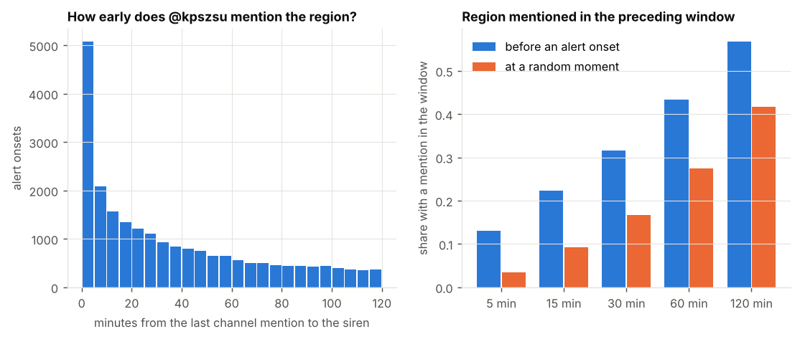

# Air raid alert forecasting for Ukraine

Short-term probabilistic forecasts of air raid alerts for the 24 regions of Ukraine
(23 oblasts + Kyiv City). At the end of each hour, the model gives the probability that an
alert will be active in each region 1, 3, 6, 12 and 24 hours later.

Data source: [Vadimkin/ukrainian-air-raid-sirens-dataset](https://github.com/Vadimkin/ukrainian-air-raid-sirens-dataset)
(the volunteer/eTryvoga log, updated daily, 25.02.2022 to today).

## Results (test = latest 28 days of origins, 14.09–12.10.2026, weekly walk-forward refit)

Data snapshot: alert log downloaded on 12.10.2026 (last full hour 00:00 UTC), Telegram posts
up to 12.10.2026 08:33 UTC.

Brier score (mean squared error of the probability, lower is better):

| model | h = 1 | h = 3 | h = 6 | h = 12 | h = 24 |
|---|---|---|---|---|---|
| persistence (current state continues) | 0.215 | 0.341 | 0.343 | 0.352 | 0.344 |
| climatology (28-day rate at that hour of day) | 0.185 | 0.185 | 0.185 | 0.185 | 0.185 |
| v1: logistic regression | 0.164 | 0.187 | 0.187 | 0.189 | 0.190 |
| v2: LightGBM + neighbours + national context | 0.132 | 0.178 | **0.179** | **0.180** | **0.181** |
| v2, trained only on the Telegram-covered year | 0.132 | 0.178 | 0.179 | 0.180 | 0.181 |
| v3: v2 + Telegram (@kpszsu) text features | **0.131** | 0.178 | 0.180 | 0.181 | 0.182 |

ROC-AUC: v2 0.860 at h = 1 and 0.76–0.77 at h = 3…24; v3 0.863 at h = 1. The probabilities are
well calibrated (`reports/figures/04_reliability.png`). Validation-month numbers (same protocol)
are in `reports/metrics/validation_scores*.csv`.

**What the numbers say**

* Most of the h = 1 skill comes from alerts that are already running. Restricted to moments with
  *no* alert in progress (i.e. predicting a **new** alert), LightGBM beats climatology by ~8–9 % at
  h = 1 and by 2–3 % at longer horizons; logistic regression by 4 % at h = 1 and not at all beyond
  (`reports/metrics/test_scores_quiet_origins.csv`).
* The Air Force Telegram channel mentions a region before its siren more often than by chance:
  32 % of onsets have a mention in the preceding 30 min, vs 17 % of random moments
  (`reports/figures/07_text_lead_time.png`).
* Adding the channel (v3) helps **only at h = 1**: −0.85 % Brier vs v2 trained on the same window
  (day-block bootstrap 95 % CI of ΔBrier [−0.0020, −0.0002]; 0.75 % of bootstrap replicates show no
  gain — borderline after a Bonferroni correction for the 10 comparisons). At h ≥ 6 it is slightly
  *worse* (not significant). The same pattern appeared on validation, so the recommended
  production setup is v3 for the next hour and v2 for longer horizons.
* Beyond ~3 hours every model is close to climatology: the alert history and the channel describe
  attacks already under way, not attacks being prepared.

The full story of what was tried and what failed is in [`docs/experiment_log.md`](docs/experiment_log.md).





## Data

* **Alerts**: [Vadimkin/ukrainian-air-raid-sirens-dataset](https://github.com/Vadimkin/ukrainian-air-raid-sirens-dataset),
  volunteer (eTryvoga) log at oblast level, downloaded by `scripts/01_download_data.py`.
* **Alerts snapshot** used for the reported numbers is versioned in `data/raw/volunteer_data_en.csv`;
  running `scripts/01_download_data.py` replaces it with the newest log (which shifts the test window).
* **Telegram**: 41.9k public posts of [@kpszsu](https://t.me/s/kpszsu) (Air Force of the Armed Forces of
  Ukraine), 01.10.2025–12.10.2026, in `data/raw/telegram_kpszsu.csv`. Text features are NaN for
  origins after the last scraped post, so refresh the posts together with the alert log. Collected with
  `scripts/00_scrape_telegram.py` (Python) or `scripts/browser_scraper.js` (browser console, used here
  because t.me was not reachable from the sandbox).
* **Gazetteer**: settlement → oblast from the official KATOTTG catalogue via
  [0G3RA/ua-geo-set](https://github.com/0G3RA/ua-geo-set) (MIT), in `data/external/gazetteer.csv`.

## How leakage is prevented

* Alerts are converted to a minute-level on/off matrix. A feature for forecast origin `T`
  uses only minutes before `T`. The end time of an alert still running at `T` is never used.
* `tests/test_leakage.py` erases everything after a cut-off (drops later alerts and truncates
  running ones). It then checks that every feature for origins before the cut-off is unchanged
  (equal within float tolerance 1e-5; in practice identical). The same test is applied to the text
  features: a post published at or after the forecast moment must not change them. Other tests check
  the target against the raw alert intervals and known text-extraction edge cases.
* Training rows must have their **target** hour (not just the origin) finish before the
  evaluation period starts. Otherwise long horizons would leak test labels.
* Splits are strictly chronological: train, then validation, then test. Features, training window
  and hyper-parameters were chosen on validation (`scripts/03a_validate.py`). The test month was
  evaluated twice: first for v1/v2, and — after the v2 test result showed that new alerts are hard
  to predict — again for v3. No feature or parameter was tuned on test numbers.

## Project structure

```
air-alerts-forecast/
├── src/airalerts/          # library code
│   ├── config.py           # paths, regions, oblast adjacency graph, horizons
│   ├── data.py             # download, cleaning, minute → hourly panel
│   ├── features.py         # leakage-safe features + (origin, region, horizon) table
│   ├── text_features.py    # Telegram: gazetteer, region/threat extraction, text features
│   ├── models.py           # baselines, logistic regression (v1), LightGBM (v2, v3)
│   ├── evaluation.py       # chronological splits, metrics, calibration
│   └── plots.py            # report figures
├── scripts/
│   ├── 00_scrape_telegram.py   # public Telegram channel → CSV (Python)
│   ├── browser_scraper.js      # same, from a browser console
│   ├── 00_merge_browser_parts.py
│   ├── 01_download_data.py
│   ├── 02_build_dataset.py
│   ├── 03a_validate.py         # same walk-forward on the validation month
│   ├── 03_train_evaluate.py    # walk-forward test, metrics, figures
│   ├── 04_forecast_now.py      # forecast from the latest hour (v2, needs no fresh Telegram)
│   ├── 05_text_lead_time.py    # does the channel speak before the siren?
│   └── 06_significance.py      # bootstrap test v3 vs v2
├── tests/test_leakage.py
├── reports/{metrics,figures}/  # generated results
├── docs/experiment_log.md      # what was tried, what failed, why
└── data/{raw,processed,external}/
```

## Run

```bash
python -m venv .venv && source .venv/bin/activate
pip install -r requirements.txt
# optional: python scripts/01_download_data.py  (newest alerts; then refresh Telegram too)
python scripts/02_build_dataset.py
python -m pytest -q                  # leakage tests
python scripts/03a_validate.py       # ~8 min on a laptop
python scripts/03_train_evaluate.py  # ~8 min
python scripts/05_text_lead_time.py
python scripts/06_significance.py
python scripts/04_forecast_now.py
```

## Limitations

* Oblast-level only. Since December 2025, official sirens are often declared per raion
  (district), and the volunteer log aggregates them to the oblast.
* The newest few hours of the log can be incomplete because alerts are published after they end.
  A 3-hour margin is dropped at the edge.
* Alerts with a missing "all clear" message are capped at 24 h, and naive ones are assumed to last 30 min.
* Telegram posts can be edited after publication. The web preview shows the final text, while the
  timestamp is the original publication time, so a small leak through edits cannot be fully excluded.
* Text features exist only from October 2025, so v3 is trained on one year of data, not three.
* The text-extraction rules were tuned by reading a week of posts (4–10.10.2026) that lies inside the
  test month. The rules are generic (spellings, Kyiv districts, case endings), but this is a mild
  contamination worth knowing about.
* Part of the channel's "lead time" may be simultaneous with the siren: 5 % of onsets have a
  mention less than 1 minute earlier, which may reflect timestamp lag in the alert log.
