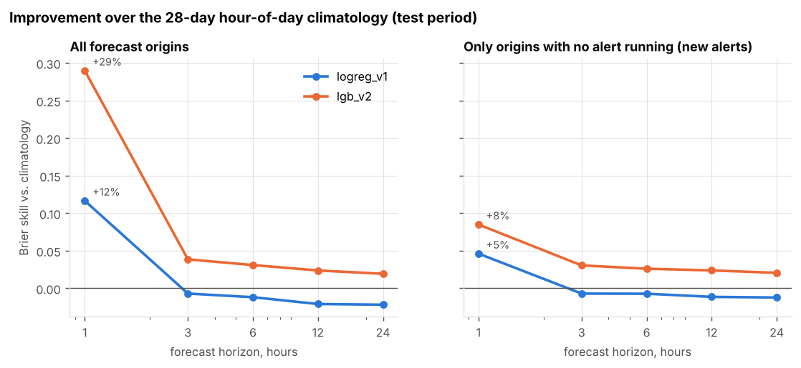
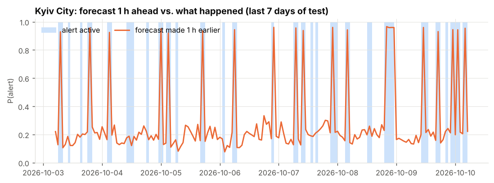

# Air raid alert forecasting for Ukraine

Short-term probabilistic forecasts of air raid alerts for the 24 regions of Ukraine
(23 oblasts + Kyiv City). At the end of each hour, the model gives the probability that an
alert will be active in each region 1, 3, 6, 12 and 24 hours later.

Data source: [Vadimkin/ukrainian-air-raid-sirens-dataset](https://github.com/Vadimkin/ukrainian-air-raid-sirens-dataset)
(the volunteer/eTryvoga log, updated daily, 25.02.2022 to today).

## Results (test = latest 28 days, 12.09–10.10.2026, weekly walk-forward refit)

Brier score (mean squared error of the probability, lower is better):

| model | h = 1 | h = 3 | h = 6 | h = 12 | h = 24 |
|---|---|---|---|---|---|
| persistence (current state continues) | 0.210 | 0.336 | 0.338 | 0.346 | 0.338 |
| climatology (28-day rate at that hour of day) | 0.184 | 0.184 | 0.185 | 0.184 | 0.183 |
| v1: logistic regression | 0.163 | 0.186 | 0.187 | 0.188 | 0.187 |
| **v2: LightGBM + neighbours + national context** | **0.131** | **0.177** | **0.179** | **0.180** | **0.180** |

ROC-AUC of v2: 0.86 (h = 1), 0.76–0.77 (h = 3…24). The probabilities are well calibrated
(`reports/figures/04_reliability.png`).

**Honest caveat.** Most of the h = 1 skill comes from alerts that are already running.
Restricted to moments with *no* alert in progress (i.e. predicting a **new** alert),
v2 beats climatology by only 8 % at h = 1 and by 2–3 % at longer horizons
(`reports/metrics/test_scores_quiet_origins.csv`). The alert history alone says little about
when the next attack starts. See [`docs/experiment_log.md`](docs/experiment_log.md) for the full story.




## How leakage is prevented

* Alerts are converted to a minute-level on/off matrix. A feature for forecast origin `T`
  uses only minutes before `T`. The end time of an alert still running at `T` is never used.
* `tests/test_leakage.py` erases everything after a cut-off (drops later alerts and truncates
  running ones). It then checks that every feature for origins before the cut-off is unchanged.
* Training rows must have their **target** hour (not just the origin) finish before the
  evaluation period starts. Otherwise long horizons would leak test labels.
* Splits are strictly chronological: train, then validation (model choices), then test.
  The test month was used only once, for the final numbers.

## Project structure

```
air-alerts-forecast/
├── src/airalerts/          # library code
│   ├── config.py           # paths, regions, oblast adjacency graph, horizons
│   ├── data.py             # download, cleaning, minute → hourly panel
│   ├── features.py         # leakage-safe features + (origin, region, horizon) table
│   ├── models.py           # baselines, logistic regression (v1), LightGBM (v2)
│   ├── evaluation.py       # chronological splits, metrics, calibration
│   └── plots.py            # report figures
├── scripts/
│   ├── 00_scrape_telegram.py   # optional: public Telegram channel → CSV
│   ├── 01_download_data.py
│   ├── 02_build_dataset.py
│   ├── 03_train_evaluate.py    # walk-forward test, metrics, figures
│   └── 04_forecast_now.py      # forecast from the latest hour
├── tests/test_leakage.py
├── reports/{metrics,figures}/  # generated results
├── docs/experiment_log.md      # what was tried, what failed, why
└── data/{raw,processed}/       # generated, not tracked by git
```

## Run

```bash
python -m venv .venv && source .venv/bin/activate
pip install -r requirements.txt
python scripts/01_download_data.py
python scripts/02_build_dataset.py
python -m pytest -q                  # leakage tests
python scripts/03_train_evaluate.py  # ~5 min on a laptop
python scripts/04_forecast_now.py
```

## Limitations

* Oblast-level only. Since December 2025, official sirens are often declared per raion
  (district), and the volunteer log aggregates them to the oblast.
* The newest few hours of the log can be incomplete because alerts are published after they end.
  A 1-hour margin is dropped at the edge.
* Alerts with a missing "all clear" message are capped at 24 h, and naive ones are assumed to last 30 min.
